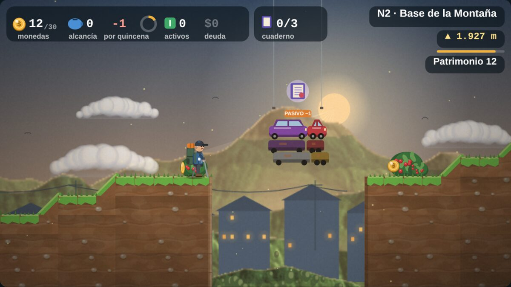
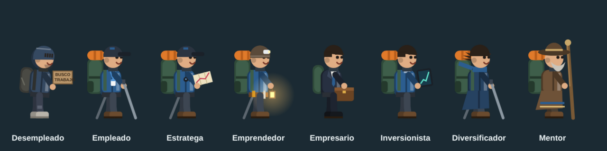
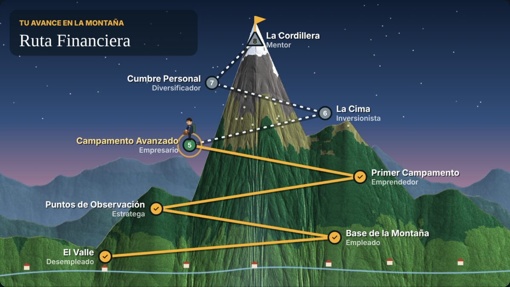
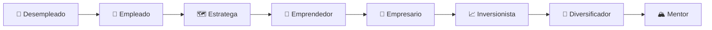
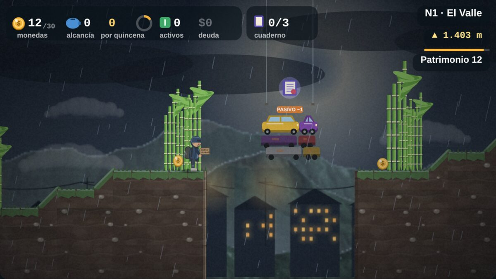
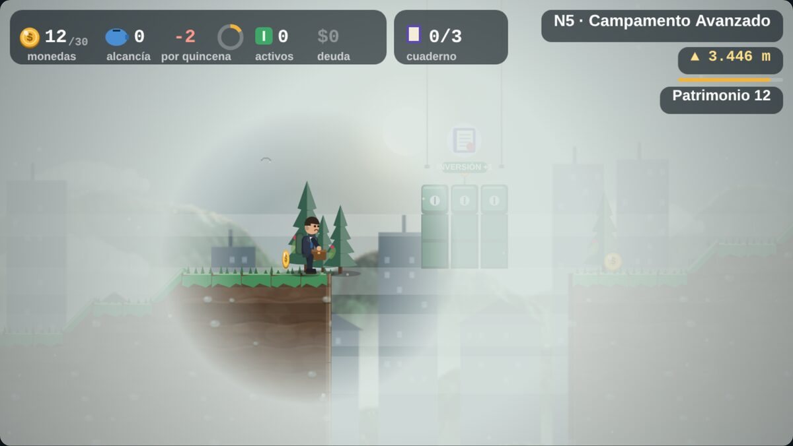
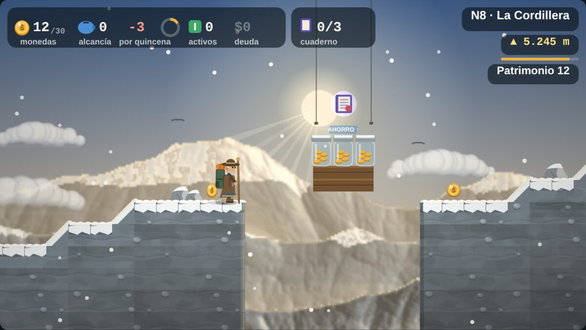
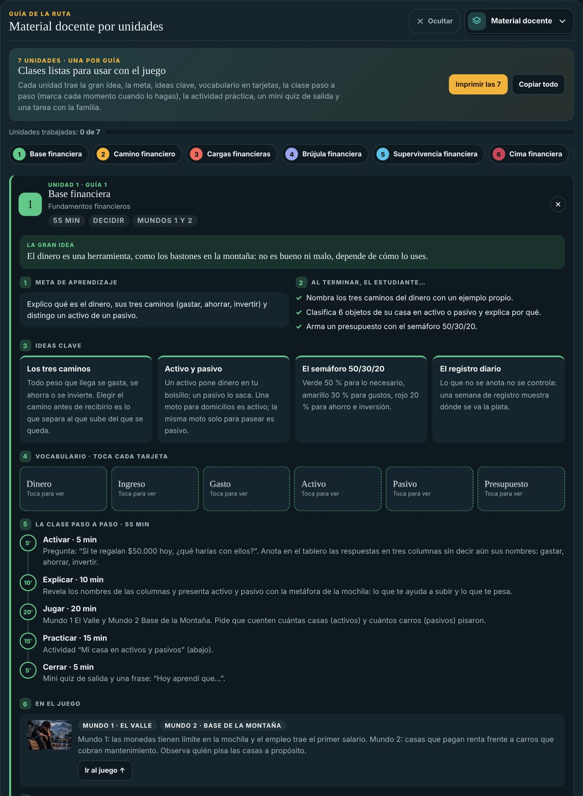
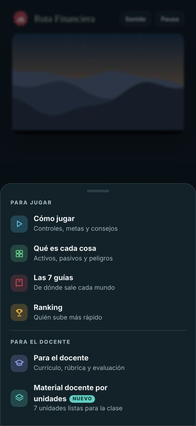

<div align="center">


# ⛰️ Ruta Financiera

### Un juego de **Ruta a la Cima** · educación financiera que se juega

*“No se trata solo de ganar dinero, sino de construir la vida que quieres.”*

[](https://passbri.github.io/gamerutaf/)
[](#-tecnología)
[](#-tecnología)
[](#)

**[Jugar](https://passbri.github.io/gamerutaf/)** · [Cómo se juega](#-cómo-se-juega) · [La montaña](#️-la-montaña-8-mundos-8-versiones-de-ti) · [Para el aula](#-para-el-aula) · [Correrlo en tu equipo](#-correrlo-en-tu-equipo)

</div>

---

## 🎒 ¿De qué se trata?

Empiezas en **El Valle** sin empleo, con una mochila vacía y un letrero de *“Busco trabajo”*. Terminas en **La Cordillera** como **mentor**: con ruana, bastón y un ingreso pasivo que paga tu vida.

Entre un punto y otro está la montaña, y la montaña **es tu dinero**:

- 🏠 **Las casas son activos.** Te pagan arriendo, aunque también cobran impuesto predial y reparaciones: dejan más de lo que cuestan.
- 🚗 **Los carros son pasivos.** Están en elevadores de taller, parqueaderos de varios pisos o colgados de una grúa. Se les caen piezas, cobran SOAT, tecnomecánica, impuesto vehicular, repuestos y gasolina, y además **cobran tiempo**: cambiar una llanta o ir al CDA te deja quieto unos segundos mientras la quincena sigue corriendo.
- 🫙 **Los frascos de ahorro te impulsan,** pero si rebotas mucho se agrietan y se rompen: el ahorro en casa es frágil.
- 📈 **Los CDT muestran su ganancia:** cada quincena que esperas suman intereses, y tú decides cuándo cobrar.
- ⛓️ **Las deudas son cadenas.** Pinchan, pesan y te hunden en el pantano de la mora.

Aquí no saltas sobre tortugas: **saltas sobre decisiones financieras**. Cada campamento solo se abre si tus finanzas están listas.

<div align="center">

<sub><b>Mundo 2 · Base de la Montaña.</b> La pila de carros parece un buen atajo… hasta que cobra el mantenimiento.</sub>
</div>

---

## 🧗 Tu personaje evoluciona

Cada mundo cambia la ropa y el equipo del senderista según la fase financiera que alcanzó:

<div align="center">

</div>

| | Rol | Lo que lo delata |
|:-:|---|---|
| 1 | **Desempleado** | Mochila gastada y letrero de “Busco trabajo” |
| 2 | **Empleado** | Carné en el pecho y bastones prestados |
| 3 | **Estratega** | Un mapa con la gráfica de su ahorro |
| 4 | **Emprendedor** | Linterna frontal: trabaja hasta tarde |
| 5 | **Empresario** | Traje y maletín |
| 6 | **Inversionista** | Tableta con su portafolio al alza |
| 7 | **Diversificador** | Abrigo largo y bufanda al viento |
| 8 | **Mentor** | Ruana, sombrero, barba y bastón de guía |

---

## 🏔️ La montaña: 8 mundos, 8 versiones de ti

<div align="center">

</div>

| Mundo | Campamento | Rol | Paso financiero | Para abrir el campamento |
|:-:|---|---|---|---|
| 1 | El Valle | Desempleado | Identificación de ingresos | Tener un empleo (salario) |
| 2 | Base de la Montaña | Empleado | Control de gastos | Llegar con 10 monedas o más en la mano |
| 3 | Puntos de Observación | Estratega | Creación de ahorro | 15 monedas o más en la alcancía |
| 4 | Primer Campamento | Emprendedor | Inversiones inteligentes | Al menos 1 activo |
| 5 | Campamento Avanzado | Empresario | Diversificación de recursos | Activos de 2 tipos distintos |
| 6 | La Cima | Inversionista | Eliminación de pasivos | Cero deudas |
| 7 | Cumbre Personal | Diversificador | Construcción de patrimonio | Patrimonio de 80 o más |
| 8 | La Cordillera | Mentor | Libertad financiera | Ingreso pasivo ≥ costo de vida |



<table>
<tr>
<td width="50%"><br><sub><b>El Valle.</b> Monedas con límite de mochila y el primer empleo.</sub></td>
<td width="50%"><br><sub><b>Campamento Avanzado.</b> Niebla, costos ocultos y cajas de inversión.</sub></td>
</tr>
<tr>
<td colspan="2"><br><sub><b>La Cordillera.</b> El mentor sobre la nieve, junto a los frascos de ahorro.</sub></td>
</tr>
</table>

---

## 💸 Lo que encuentras en el camino

| Te ayuda ✅ | Te quita ❌ | Te pone en riesgo ⚠️ |
|---|---|---|
| 🪙 **Monedas:** tu dinero, con límite en la mochila | 🐜 **Gastos hormiga:** salta encima para recuperar la moneda | 🐆 **Fieras:** los imprevistos de la vida |
| 💵 **Billetes:** ingresos extra | 🏷️ **Vitrina “¡solo hoy!”:** la compra por impulso | ⛓️ **Cadenas de deuda:** pinchan si las tocas |
| 🐷 **Alcancía:** págate primero; te salva de los golpes, pero cada golpe la agrieta | ✨ **Pasivos disfrazados:** brillan, pero cobran cada quincena | 🟫 **Pantano de la mora:** frena si cargas deudas |
| 🏠 **Casas:** activos que pagan renta | 🏍️ **Vehículos:** rápidos, pero pesan en la mochila | 🧗 **Muros de escalada** y 🌊 **ríos** con piedras que se hunden |
| 📈 **CDT:** la ganancia crece cada quincena | 🤝 **El gota a gota:** plata rápida, cadena larga | 🌫️ **Inflación, tarjetas, bancos con comisiones y pirámides** |

Si tienes una duda, el **Mentor de la Cordillera** responde preguntas de finanzas con respuestas sacadas de las 7 guías (sin chat libre: el lenguaje está controlado y funciona sin internet).

### 😈 Los jefes financieros

| Personaje | Qué hace | Cómo se vence |
|---|---|---|
| **Don Gota**, prestamista ilegal | Lanza “cuotas del 20 %” y, si lo tocas, te “presta” a la fuerza y llega el cobrador | Salta 3 veces sobre él (“¡No le pido plata!”) o ten un fondo de emergencia de 10: así no lo necesitas |
| **Crédito Fácil**, asesor de créditos impagables | Desenrolla un contrato “preaprobado”: si lo pisas, firmas una cuota más alta que tu sueldo | Salta 3 veces sobre él: “¡Leo la letra pequeña!”, “¡Calculo la cuota!”, “¡No firmo!” |

### 🎯 Enemigos que lanzan y te quitan plata

Cada mundo tiene **al menos dos enemigos distintos** que lanzan cosas de la vida financiera. Se vencen saltando dos veces sobre ellos.

| Personaje | Lanza | Te quita |
|---|---|---|
| **Señor Scroll** (mucho tiempo en el celular) | Notificaciones | 1 moneda y 1 segundo distraído |
| **El Vendedor de Vitrina** (compras por impulso) | Etiquetas de “¡solo hoy!” | 1 moneda |
| **Doña Tarjeta Dorada** (deuda con tarjeta) | Tarjetas con interés del 30 % | 1 moneda y 2 de deuda |
| **Ladrones en la calle** | Esperan en la calle y te siguen si los pasas; roban el celular, la billetera, el bolso o el dinero | Si te roban, pierdes eso y **vuelves al inicio del mundo**. Písalo para detenerlo: “ROBO EVITADO” y +2 |
| **Don Político** (decretos) | Decretos que suben el mercado, la gasolina o crean un impuesto nuevo | −1 y un costo extra por 2 o 3 quincenas; el arroz de las tiendas también sube. Se vence con “¡Voto informado!” |
| **El Hacker** (robo cibernético) | Correos de phishing: “¡Ganaste un premio! Dame tu clave” | −2 y puede vaciar media billetera de bitcoin. Se vence con “¡No comparto mis claves!” |
| **Globos de la inflación** (arroz, pasaje, arriendo…) | Bajan hacia ti y, si alcanzan tu cabeza, te elevan | Mientras flotas pierdes poder de compra; salta 3 veces para reventarlos y soltarte (o písalos desde arriba). Con una inversión pierdes más lento |
| **Doña Inflación** (sube los precios) | Etiquetas de precio +10 % | No te roba: el efectivo quieto compra 10 % menos (mano y alcancía). Si tienes una inversión, como un CDT, la alcancía no pierde |
| **El Tahúr** (apuestas y ludopatía), junto a un **tragamonedas** | Fichas de apuesta | 2 monedas; el tragamonedas, 3 |

**Don Ruina, el Gran Estafador** (Mundo 8) es **dos veces más grande** que el senderista: lanza sacos de “estafa” y salta para crear ondas de “TODO O NADA” que se llevan **todo lo que tienes en la mano**. La alcancía queda a salvo y un seguro (casco o cuerda) salva la mitad. Se vence pisando su sombrero cinco veces.

### 🌪️ Desastres en cada mundo

| Mundo | Desastres |
|---|---|
| 1 · El Valle | Derrumbe en el barranco |
| 2 · Base de la Montaña | Inundación |
| 3 · Puntos de Observación | Derrumbe e inundación |
| 4 · Primer Campamento | Terremoto y quiebra |
| 5 · Campamento Avanzado | Inundación y quiebra |
| 6 · La Cima | Terremoto y derrumbe |
| 7 · Cumbre Personal | Quiebra e inundación |
| 8 · La Cordillera | Terremoto y derrumbe |

Cada desastre avisa antes, tiene su lección (seguros, fondo de emergencia, diversificar) y se puede esquivar: subir a lo alto en la inundación, saltar las rocas del derrumbe, llevar casco en el terremoto, tener activos de dos tipos en la quiebra.

### 🔀 Cada partida es distinta

Los tramos de cada mundo se reordenan y cambian en cada partida, y los jefes aparecen en lugares distintos. Lo que enseña cada mundo (puntos de control, páginas del cuaderno, el empleo, la persona que ayuda) siempre está. Para competencias, en la portada se elige **Ruta fija**: igual para todos.

En el camino también aparecen **personas que te ayudan**, **cartas de concepto** que se responden como en un juego de cartas, y el **Diario del viajero**, que te cuenta a dónde se fue tu dinero.

---

## 🎮 Cómo se juega

| Acción | Teclado | Ratón | Táctil |
|---|---|---|---|
| Caminar | <kbd>←</kbd> <kbd>→</kbd> o <kbd>A</kbd> <kbd>D</kbd> | Clic donde quieres ir | Botones en pantalla o toca el camino |
| Saltar (mantén para subir más) | <kbd>Espacio</kbd>, <kbd>↑</kbd>, <kbd>W</kbd> | Clic arriba del senderista | Botón **Saltar** |
| Trepar un muro | Mantén la flecha hacia el muro | — | Mantén la dirección |
| Pausa | <kbd>P</kbd> o <kbd>Esc</kbd> | Botón **Pausa** | Botón **Pausa** |
| Pantalla completa | <kbd>F</kbd> | Botón **Pantalla** | Botón **Pantalla** |

**Pantalla y estilo:** juega en pantalla completa y elige el estilo (Clásico, Vívido, Cálido, Cine, Alto contraste, Descanso visual o Retro) y el tamaño (Normal, Grande o Enfocado).

**Tres niveles de dificultad:** Explorador (10 a 13 años), Senderista y Montañista.

**Registro y ranking:** escribe tu apodo, colegio, grado, grupo, país y ciudad (se editan en cualquier momento con el botón **Perfil**) y compite por ver **quién llega más rápido a la cima**.

---

## 🏫 Para el aula

**100 consejos de inteligencia financiera.** En el menú inferior hay 100 tarjetas que se voltean, en 8 categorías (ahorro, presupuesto, deudas y crédito, inversión, protección, consumo, ingresos y mentalidad), cada una con una acción para hacer hoy y un botón de consejo al azar.

**Código de clase.** En *Para el docente* cada profesor escribe su nombre, cargo, colegio y ciudad, dibuja su firma o la sube como PNG con fondo transparente (si tiene fondo blanco, el juego lo quita) y crea un código (por ejemplo `RAC-7K2QMX`). Sus estudiantes lo escriben en su registro: compiten en el ranking de la clase y su diploma sale con los datos y la firma del docente. Si el juego no está conectado al ranking compartido, el docente comparte el código largo (`RAC1.…`), que funciona en cualquier dispositivo.

Ruta Financiera nació en el aula y está pensada para usarse en ella.

- 🎯 **Un resultado de aprendizaje por mundo**, alineado con las competencias de las orientaciones del MEN para la educación económica y financiera: **decidir, administrar, planear y gestionar**.
- 📊 **Evidencias que el juego mide solo:** al terminar, el docente ve un resumen con lo logrado, lo que está en proceso y lo que falta.
- 🧪 **Evaluación completa:** prueba diagnóstica y final de 5 cartas con retroalimentación inmediata y un resumen carta por carta, una carta formativa en cada campamento con repaso espaciado y una rúbrica sencilla por mundo.
- 📚 **Material docente por unidades:** 7 clases listas, una por guía. Están dentro del juego, en **Menú → Material docente por unidades**.

<table>
<tr>
<td width="62%"></td>
<td width="38%">

**Cada unidad trae:**

1. 💡 La gran idea, con la metáfora de la montaña
2. 🎯 La meta y los logros esperados
3. 🔑 Ideas clave
4. 🃏 Vocabulario en tarjetas que se voltean
5. ⏱️ La clase paso a paso, con tiempos y casillas para marcar
6. 🎮 Qué mirar en el juego
7. ✍️ Una actividad práctica con materiales y producto
8. ✅ Un mini quiz de salida con retroalimentación
9. 💬 Preguntas para conversar y tarea con la familia
10. 🧩 Ideas para quien necesita apoyo y para quien va rápido

Todo se puede **copiar** o **imprimir**.

</td>
</tr>
</table>

<div align="center">
<br>
<sub>La guía vive en un menú tipo app y se queda oculta mientras juegas.</sub>
</div>

---

## 📖 Las 7 guías de Ruta a la Cima

El contenido del juego sale de las siete guías de Ruta a la Cima:

| # | Guía | Tema |
|:-:|---|---|
| 1 | **Base financiera** | Fundamentos financieros |
| 2 | **Camino financiero** | Generación de ingresos |
| 3 | **Cargas financieras** | Transforma pasivos en activos |
| 4 | **Brújula financiera** | Mentalidad financiera |
| 5 | **Supervivencia financiera** | Estrategias de protección |
| 6 | **Cima financiera** | Indicadores financieros |
| 7 | **Ascenso financiero** | Tu viaje paso a paso |

---

## 💻 Correrlo en tu equipo

No necesitas instalar nada. El juego entero es un solo archivo HTML.

```bash
git clone https://github.com/PassBri/gamerutaf.git
cd gamerutaf
python3 -m http.server 8000
# abre http://localhost:8000
```

También puedes abrir `index.html` con doble clic. Con un servidor local las imágenes y el ranking funcionan mejor.

### Publicarlo con GitHub Pages

En **Settings → Pages**, elige **Deploy from a branch**, la rama `main` y la carpeta `/ (root)`. En un par de minutos el juego queda en `https://passbri.github.io/gamerutaf/`.

---

## 🛠️ Tecnología

| | |
|---|---|
| **Motor** | HTML5 Canvas 2D propio, sin librerías ni motores externos |
| **Resolución** | Lienzo lógico de 640 × 360 que se escala a cualquier pantalla |
| **Física** | Paso fijo a 60 Hz; el juego se recupera solo de cualquier error de dibujo |
| **Arte** | Montañas con relieve por píxel, luz por mundo, niebla, grano y viñeta |
| **Dinero propio** | Moneda de la Ruta (canto de oro y centro de lacre con la cordillera y la bandera), billetes de papel crema, bonos con sello, diamantes, lingotes y joyas; carros, motos, ciclas y aviones en lacre, oro y crema |
| **Salud financiera y muerte financiera** | Un medidor de 0 a 100 baja con malas decisiones (gota a gota, apuestas, pasivos, compras por impulso, gastar más de lo que ganas) y sube con ahorro, inversión y finanzas sanas. Si llega a 0 hay una muerte financiera: el mundo pierde el color, el electrocardiograma se apaga, aparece una lápida y se explica la insolvencia de persona natural (Ley 1564 de 2012) antes de volver a empezar el mundo con las deudas negociadas |
| **La Muerte Financiera (personaje)** | Una figura encapuchada con calavera, guadaña con la gráfica de una caída, cinturón de monedas, cuenta VENCIDA y libro de DEUDAS. Aparece y desaparece en todos los mundos (más seguido si tu salud es baja); se aleja saltando sobre ella. En La Cordillera es la batalla final: bloquea la cima, ataca con la guadaña y lanza facturas vencidas, y solo se le hace daño cuando queda cansada |
| **Trading y tragamonedas** | El puesto de trading en vivo abre operaciones de 3 con apalancamiento x4 y 1 de comisión: a veces se gana, casi siempre se pierde. El tragamonedas paga 2 o un jackpot de 8, pero 4 de cada 5 jugadas pierden 3 |
| **Diploma por niveles** | Oro, Plata o Bronce según estrellas, deudas, patrimonio, inversión, DataCrédito y muertes financieras; el Bronce dice cuál es el siguiente paso. El negocio cuenta como activo e ingreso |
| **Celular** | Al empezar un mundo en un celular el juego pasa a pantalla completa; en vertical pide girar el celular; botones táctiles de 44 px. Calidad gráfica automática, alta o baja |
| **Aula** | Avance de mi clase (estudiante, mundo, resultados de aprendizaje, pruebas, salud, muertes y diploma, con descarga en CSV), 15 medallas que se guardan entre partidas, formalización del negocio y caja del negocio con sueldo de dueño |
| **Moverse y defenderse** | ↓ o S para agacharse (esquiva la guadaña), Shift para correr un 45 % más rápido y X para defenderse con el bastón: decir NO aparta gastos hormiga, lanzadores, ladrones, facturas y a la Muerte Financiera. En el celular hay botones Agachar, Correr y ¡NO! |
| **Celular vertical** | En vertical el juego llena la pantalla con un primer plano (cámara más cerca del senderista) y el tablero arriba |
| **Cuentas claras** | Cada objeto suma su valor (moneda 1, billete 2, bono 2, joya 2, lingote 3, diamante 4); si la mochila está llena, lo que sobra va a la alcancía. Bajo el patrimonio se ve cuánto tienes y cuánto debes, la tarjeta de quincena detalla ingresos, gastos y la pérdida de valor de los pasivos, y el campamento muestra el balance completo: lo que tienes menos lo que debes |
| **Números de la vida real y ranking** | En el campamento: ingresos y gastos por quincena, tasa de ahorro, cuotas sobre ingresos, meses de fondo de emergencia y libertad financiera, con las recomendaciones reales (ahorrar 10–20 %, cuotas hasta 30 %, fondo de 3 a 6 meses). El ranking muestra tarjetas con el tiempo del mundo, el general y los 8 tiempos por mundo, y los datos financieros de cada partida |
| **Plata bajo el colchón** | Debajo del colchón hay bastante plata guardada (12 a 26 según el mundo). Al tocarlo, el senderista levanta el colchón y los billetes salen volando hacia él; una cuarta parte está dañada por la humedad y los ratones |
| **La ciudad** | Corrientazo, baño público, tienda de ropa (necesidades), cine, restaurante, compras en línea y agencia de viajes (gustos), centro comercial (tentación), paseo al parque (gratis) y streaming (suscripción con primer mes gratis). Se entra quedándose en la puerta; los gustos están bien hasta el 30 % de los ingresos de la quincena (regla 50/30/20) y el viaje solo se paga con la alcancía |
| **Indicadores de las guías** | En *Mi balance* del campamento: semáforo del balance, índice de endeudamiento (pasivos ÷ activos × 100, óptimo bajo 30 %), patrimonio neto y liquidez (Guía 6); las tres mochilas 50/30/20; señales de alerta; Cash Flow Index para decidir qué deuda pagar primero (Guía 3) y la meta de cada mundo (Guía 7, 8.7). El HUD muestra el semáforo junto al patrimonio |
| **Ranking ordenado** | Vista **Resultado global por jugador** (una fila por jugador: primero quien más mundos termina; si empatan, el menor tiempo total) o por mundo. Cada tarjeta muestra siempre activos, pasivos, patrimonio, deudas, ahorros e inversiones; el botón **Ver detalles** despliega el tiempo de los 8 mundos y los indicadores de salud financiera (balance, endeudamiento, tasa de ahorro, salud, ingresos, gastos). Botones para desplegar o recoger todo |
| **Mundos más largos** | Cada mundo suma de 9 a 12 tramos nuevos (unos 35 % más de recorrido), escogidos con la semilla de la partida; en Ruta fija son iguales para todos |
| **Relieve variado y cada vez más empinado** | Los tramos ya no se unen con la misma rampa: entre cada uno hay laderas, terrazas que se saltan, riscos con cornisa, lomas, bajadas y valles, generados con la semilla de la partida (cada partida es distinta; en Ruta fija es igual para todos). La pendiente media sube mundo a mundo: unas 2 filas por tramo en El Valle y más de 5 en La Cordillera, donde la montaña es casi el triple de alta |
| **La Expedición: 8 mundos nuevos (16 en total)** | Al terminar La Cordillera se abre una segunda travesía, cada mundo en un terreno distinto y con su lección: ordenados por su altitud real en Colombia: 9 La Costa, playa y manglar, 0 m (salir de las deudas), 10 Las Salinas, 20 m (impuestos y formalidad, con oficina de impuestos para declarar la renta), 11 El Desierto, 400 m (resistir la escasez), 12 El Valle del Río, 600 m (flujo de caja), 13 El Bosque Andino, 1.800 m (protección y seguros), 14 El Páramo (interés compuesto y largo plazo), 15 El Nevado (pensión y vejez) y 16 La Gran Cordillera (legado, con la Prueba del Gran Mentor). Cada mundo tiene meta de campamento, reto, páginas del Cuaderno, preguntas, resultado de aprendizaje, desastres, arena y jefe propio: Don Mora, Doña Fuga, Señor Imprevisto, Doña Escasez, El Evasor, Don Ya, Don Mañana y El Gran Derroche. Mapa propio de la Expedición: un viaje por ocho escenarios distintos que suben hacia la derecha (costa con mar y palmeras, salinas con piscinas de sal y flamencos, desierto con meseta, valle del río, bosque andino, páramo con laguna y frailejones, nevado y cordillera con glaciares), con la altitud de cada mundo; segundo final y ranking con los 16 mundos y la Expedición completa |
| **Huella verde** | Indicador de 100 puntos. Pasar por zonas dañadas (basura, río contaminado, bosque talado, minería ilegal, residuos, páramo quemado, glaciar que se derrite) resta puntos y encarece la vida unas quincenas (costo ambiental). Restaurar la zona (sembrar, limpiar, apagar, denunciar) cuesta 1 y devuelve puntos; los atajos que dan plata rápida dañando la naturaleza restan mucho. Aparece en el HUD, en los indicadores del campamento, en el ranking, en la sección «Tu huella ambiental» del resultado final y como medalla en el certificado, y da la medalla Guardián de la montaña |
| **Combate de jefe en cada mundo** | Al final de cada mundo hay una arena con escenario (público, pancarta, antorchas, reflectores, ring y lemas de las guías) y un combate al estilo de los juegos de pelea: barras de vida, reloj de 99, «¡PELEA!» y «¡K.O.!». El jefe se vence con 10 golpes (6 en Explorador, 12 en Montañista): golpes altos que se esquivan agachándose, barridas que se saltan, guardia, combos y ataques especiales. Si te noquea, pierdes 3 y empieza otro round. Jefes: Don Antojo (gastos hormiga), Doña Compras (compras compulsivas), Don Inflador (inflación), Lujo Brillante (pasivo disfrazado), Don Canasta (no diversificar), Doña Cuota Eterna (pago mínimo) y Señor Pirámide (estafa piramidal); en La Cordillera, la Muerte Financiera con 10 golpes. El campamento solo se abre al vencerlo |
| **Senderista del Mundo 1** | Se ve pobre y desempleado: ropa desteñida con parches y rotos, bolsillos vacíos volteados, zapato roto y el banderín BUSCO EMPLEO |
| **Oportunidad de negocio** | Cada mundo trae un negocio más grande: carrito de empanadas (capital 6, +2), tienda de barrio, café con mirador, food truck, panadería, hostal de montaña, fábrica de chocolate y empresa de tecnología educativa (capital 20, +6). Te detienes en la puerta para invertir (con tu plata o tu alcancía). El primer mes cubre costos, hay meses flojos y temporada alta; puedes ampliarlo o escalarlo traspasando el pequeño |
| **Poderes** | Sobre una apacheta: la **mochila del fondo de emergencia** hace crecer al senderista y le deja aguantar un golpe; la **pluma de cóndor** da una **racha de disciplina** de 8 s en la que corre más rápido, no recibe daño y amarra los gastos que toca |
| **Bitcoin y colchón** | Billetera de bitcoin cuyo valor sube y baja cada quincena; sin la **frase semilla** puedes olvidar la clave y perderlo todo. La plata **debajo del colchón** se la comen la humedad, los ratones y la inflación hasta que la llevas a una alcancía |
| **Gastos hormiga** | Cada hormiga lleva girando encima su gasto: el café de la esquina, la gaseosa, la empanada, las papas, los chicles o el domicilio por app |
| **Hábitos de inteligencia financiera** | **Cofre de paciencia** (2 ya o 6 si esperas), **dos tiendas** con el mismo arroz (el precio grande esconde el envío), **curso técnico** que sube el salario para siempre, **senderista en apuros** al que ayudas sin desfinanciarte, **kiosco de memecoin** con efecto manada que estalla, **interés compuesto** en los CDT, **pensión y cesantías** automáticas, **puntaje DataCrédito** que sube con cuotas a tiempo y baja con acuerdos de pago, y el presupuesto del campamento que se vuelve "págate primero" automático |
| **Eventos de la vida** | Suben los servicios públicos, los alimentos o la cuota de administración; tormentas con rayos, sequía, ola invernal, guerra lejana que sube el combustible, enfermedad, familiar enfermo y reforma tributaria: el fondo de emergencia paga primero; sin él, quedas debiendo |
| **Terremoto** | La tierra se abre en grietas y a las casas se les caen las tejas; si tienes casa, el seguro cubre la reparación |
| **Drones** | Las plataformas que cuelgan las cargan drones de la Ruta y los carros sobre el vacío son carros voladores |
| **Lotes de inversión** | En el suelo, con cerca de guadua y letrero de papel: llegas con las monedas que pide y siembras un árbol que te paga cada quincena |
| **Final** | El senderista sube la última ladera, clava la bandera de la cumbre al amanecer y aparece **¡Cima conquistada!** con un certificado descargable de **Excelente inteligencia financiera**, con papel de seguridad, guilloche de oro, emblema de la Ruta, medallas con los logros del jugador, firmas, sello de lacre, código de verificación y una marca de agua con sus activos, pasivos, ahorro, patrimonio e inversiones |
| **Enemigos vencidos** | Quedan amarrados con un candado, reciben el sello rojo **PASIVO CONTROLADO** (con lo que controlaste: tiempo en el celular, deuda de la tarjeta, estafa denunciada…) y estallan en dinero |
| **Alcancía viva** | Las monedas vuelan una a una hasta la alcancía, su vientre de vidrio se llena y brilla al completar el fondo de emergencia; con los golpes se agrieta y al tercero cae y se rompe en pedazos |
| **Personajes** | Proporciones naturales (cabeza más pequeña, cuello, piernas más largas), ojos con brillo, nariz, manos y zapatos con volumen; todos se pintan con la luz de su mundo, luz de borde y contorno |
| **Animación** | Todos los personajes comparten un esqueleto con cinemática inversa: pie fijo al apoyar (sin patinar), cadera que sube al caminar y baja al correr, brazos en oposición, lanzamientos con preparación y seguimiento, reacción al golpe y respiración. El puma trota en diagonal, la culebra ondula y la hormiga camina en trípode |
| **Controles** | Teclado, ratón (clic para ir) y táctil |
| **Guardado** | Progreso, ranking local y material docente en `localStorage` |
| **Ranking en línea** | Base de datos compartida cuando corre como artifact de Claude; en otros sitios usa el ranking local |
| **Accesibilidad** | Navegación por teclado, foco visible, `aria` en menús y cartas, y respeto por *reducir movimiento* |

```
gamerutaf/
├── index.html        ← el juego completo (HTML + CSS + JS)
├── art/
│   ├── cima.jpg      ← portada
│   └── m1…m8.jpg     ← ilustración de cada mundo
└── docs/capturas/    ← imágenes de este README
```

---

## 👤 Autor

**Brian Gonzalo Suárez Acevedo**, fundador de **Ruta a la Cima**, docente de educación física en Floridablanca, Santander (Colombia) y artista visual.

Ruta Financiera hace parte de Ruta a la Cima, un sistema de desarrollo personal que usa la montaña como mapa: subir no es un salto, es un camino por fases.

<div align="center">

---

**¿Listo para subir?**

[](https://passbri.github.io/gamerutaf/)

<sub>© 2026 Ruta a la Cima · Brian Gonzalo Suárez Acevedo. Todos los derechos reservados.</sub>

</div>
